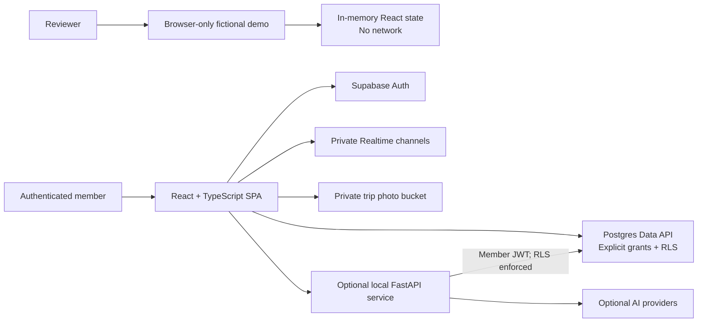

# Trailhead Camp Planner

Trailhead Camp Planner is an open-source group camping workspace. It turns the scattered work of coordinating people, campsites, shared gear, shopping, costs, and updates into one role-aware plan.

The repository is designed to be evaluated safely: its default fictional demo runs entirely in the browser, makes no network requests, and requires no account or cloud project.

## The problem

A weekend trip becomes an operations problem as soon as several households share reservations, equipment, purchases, and decisions. Group chat is useful for conversation but poor at ownership, permissions, readiness, and settlement. Trailhead Camp Planner gives the group a shared operating picture while keeping high-impact actions behind clear role boundaries.

## Product scope

- Group trips with dates, destination, trip type, and members
- Director, counselor, CIT, and camper roles with progressively narrower permissions
- Email invites and explicit invite acceptance
- Campground, campsite, tent, vehicle, camper assignment, and itinerary planning
- Shared gear, shopping, and personal packing lists
- Expense capture, household or individual splits, and settle-up summaries
- A private trip bulletin with replies, presence, and optional member-only photos
- AI-assisted planning that proposes structured changes for review; a person must confirm the selected changes before any write

## Try the demo

Requirements: Node.js 20 or newer.

```bash
git clone https://github.com/kyle-matthies/trailhead-camp-planner.git
cd trailhead-camp-planner/frontend
npm ci
npm run dev
```

Open the local URL printed by Vite and choose **Explore the fictional demo**. No `.env`, backend, Supabase project, or provider key is required. Refresh the page to reset the in-memory data.

The demo includes all central workflows and a deterministic AI proposal flow. It intentionally does not send email, upload photos, persist state, or contact an AI provider.

## Roles and permissions

| Role | Read trip | Add or claim collaborative items | Edit trip content | Manage members and roles |
| --- | --- | --- | --- | --- |
| Director | Yes | Yes | Yes | Yes |
| Counselor | Yes | Yes | Yes | No |
| CIT | Yes | Yes, within item-level rules | No | No |
| Camper | Yes | No | No | No |

The UI uses the same hierarchy to present relevant controls, while Postgres row-level security is the source of truth in connected mode.

## Architecture



The browser handles ordinary CRUD directly through a Supabase publishable key. The optional API never uses an elevated key for AI-authored data changes; it forwards the authenticated member's JWT so the same RLS policies apply. A server-side Supabase secret key is optional and isolated to Auth invite-email delivery.

See [docs/architecture.md](docs/architecture.md) for the data boundaries and request flows.

## Connected local setup

Use this only when you want a working database-backed environment. It creates a new local Supabase stack and does not connect to any existing hosted service.

Requirements:

- Node.js 20+
- A Docker-compatible container runtime
- Supabase CLI (inspect current commands with `supabase --help`)
- Python 3.12+ for the optional API

```bash
cp .env.example .env
supabase start
supabase db reset
supabase status
```

Copy the local API URL and publishable key shown by `supabase status` into `.env`, then set:

```dotenv
VITE_DEMO_MODE=false
VITE_SUPABASE_URL=http://127.0.0.1:54321
VITE_SUPABASE_PUBLISHABLE_KEY=YOUR_LOCAL_PUBLISHABLE_KEY
SUPABASE_URL=http://127.0.0.1:54321
SUPABASE_PUBLISHABLE_KEY=YOUR_LOCAL_PUBLISHABLE_KEY
```

Start the frontend:

```bash
cd frontend
npm ci
npm run dev
```

For the optional local API:

```bash
cd backend
python3 -m venv .venv
source .venv/bin/activate
python -m pip install --require-hashes -r requirements.lock
fastapi dev app/main.py
```

AI suggestions require `GOOGLE_GEMINI_API_KEY`. Voice transcription additionally requires `OPENAI_API_KEY`. Both stay in the ignored root `.env` and are read only by the backend. Without them, the database-backed planning screens still work and the fictional demo remains fully usable.

## Using a new hosted Supabase project

There is no hosted project attached to this repository. To use your own:

1. Create a new Supabase project under your own account.
2. Run `supabase login`, inspect `supabase link --help`, then link with your new project reference.
3. Review the SQL in `supabase/migrations/`, then run `supabase db push` against only that new project.
4. Add your local and intended app URLs to Supabase Auth redirect settings.
5. Put the new project URL and publishable key in your ignored `.env`; never place a secret or service-role key in a `VITE_` variable.
6. If you want managed invite emails, set `SUPABASE_SECRET_KEY` only for the server-side API. Otherwise, the app can still create a copyable invite link.
7. Run `scripts/run-rls-tests.sh` against the local stack before considering any hosted environment ready.

The migrations create generic schema only. They contain no users, trips, locations, photos, project IDs, or seed records.

## Privacy and security

- Demo people, locations, dates, expenses, and messages are fictional and live only in memory.
- The repository contains placeholders only; no hosted project, production URL, analytics ID, deployment configuration, or user dataset is included.
- Every app table has RLS enabled. Explicit Data API grants and RLS policies are kept together in migrations.
- Trip-scoped rows carry `trip_id`, and composite foreign keys prevent cross-trip references.
- Private photo paths include trip and uploader IDs; storage policies require trip membership and owner- or coordinator-level deletion rights.
- AI planning and commit are separate endpoints. The commit accepts only a reviewed allow-listed change set and executes with the member's JWT.
- `.gitignore` excludes environment files, local Supabase state, dumps, uploads, editor/agent artifacts, logs, and generated output.

See [docs/security-and-privacy.md](docs/security-and-privacy.md) for the threat model and operational checklist.

## Product decisions

- **Collaboration design:** one trip workspace replaces parallel chat threads and spreadsheets, while the bulletin remains optimized for time-sensitive group updates.
- **Permission boundaries:** roles reflect real coordination responsibilities; UI gates aid comprehension, and RLS remains authoritative.
- **Shared-cost workflow:** expenses and purchased shopping items feed one settlement model, with equal allocation as the default and explicit custom splits when fairness requires them.
- **AI review before write:** planning and execution are intentionally separate. Suggestions show the exact rows and fields to change, support partial approval, and require confirmation.

The reasoning behind these choices is recorded in [docs/decision-log.md](docs/decision-log.md).

## Verification

```bash
cd frontend
npm ci
npm run lint
npm run typecheck
npm test
npm run build

cd ../backend
python -m pip install --require-hashes -r requirements.lock
python -m pytest -q

cd ..
scripts/run-rls-tests.sh
git diff --check
```

The RLS test requires Docker and the Supabase CLI. See `.github/workflows/ci.yml` for the clean CI sequence.

## What I'd build next

- Replace the static itinerary view with dependency-aware scheduling and conflict warnings.
- Add offline-first field access with intentional sync and merge behavior.
- Let groups choose equal, household, weighted, or per-item settlement policies during trip setup.
- Add expiring photo retention controls and an export/delete workflow for trip media.
- Evaluate suggestion quality and rejection reasons without storing private trip text in analytics.

These are future product directions, not features claimed by the current release.

## Documentation

- [Product brief](docs/product-brief.md)
- [Architecture](docs/architecture.md)
- [Decision log](docs/decision-log.md)
- [Security and privacy](docs/security-and-privacy.md)

## License

[MIT](LICENSE)
